# Activity Diagram dengan Swimlane

Setiap diagram dipisahkan per proses. Swimlane menunjukkan pihak yang bertanggung jawab atas aktivitas: **Pengguna CFD**, **Sistem Web**, **Service/Model**, dan **Sistem Eksternal/Penyimpanan** bila diperlukan.

## 1. Login

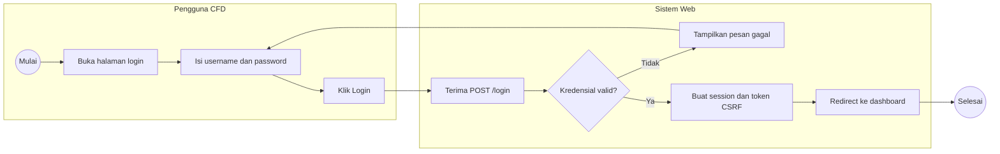

## 2. Menampilkan Dashboard

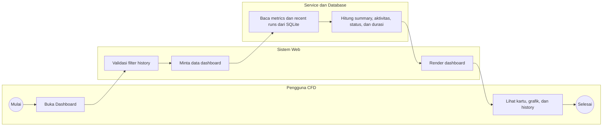

## 3. Input Parameter

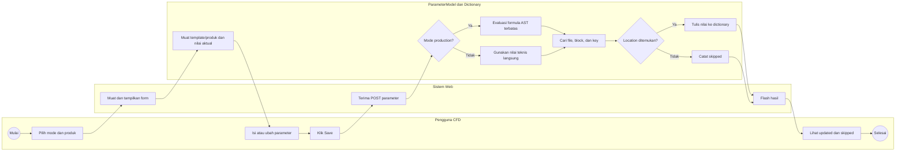

## 4. Set Processor

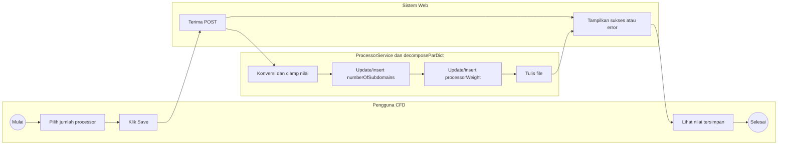

## 5. Meshing

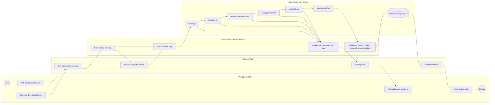

## 6. Solver

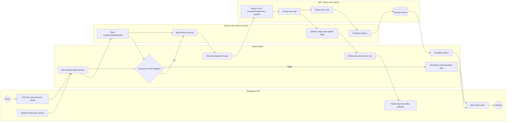

## 7. Update Graph

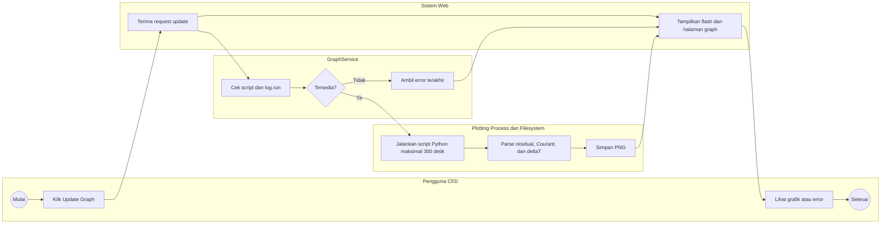

## 8. Visualisasi ParaView di Browser

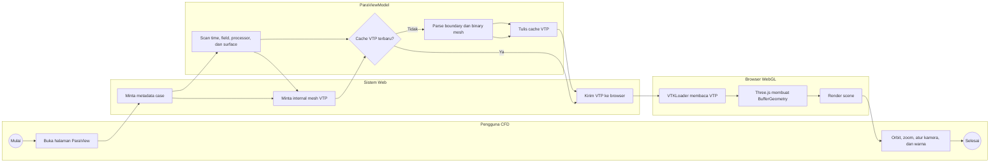

## 9. Remote ParaView

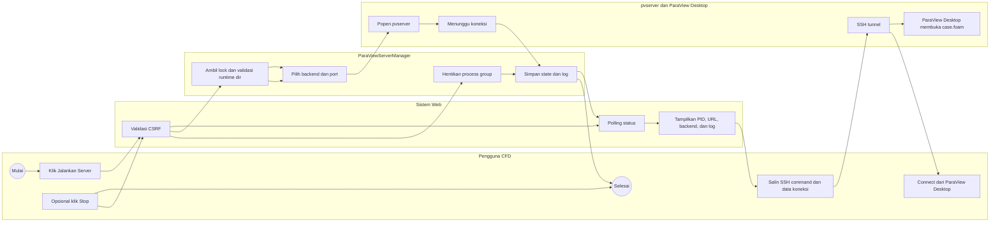

## 10. Get Report

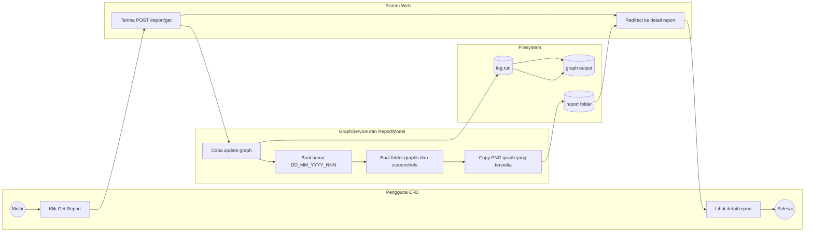

## 11. Capture Report

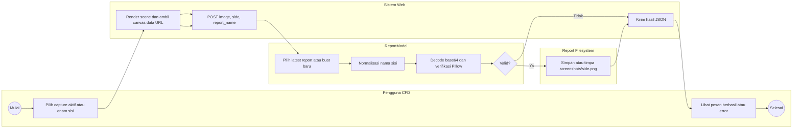

## 12. Export PDF Report

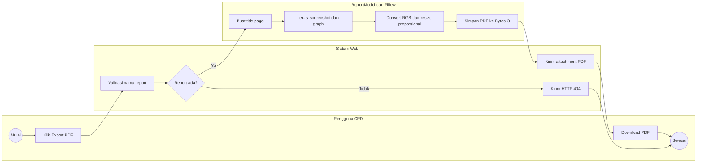

## 13. Delete Report

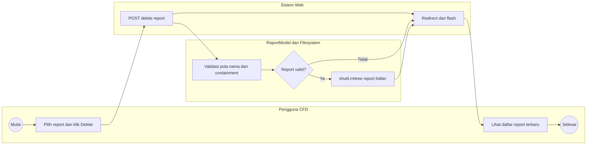

## 14. Logout

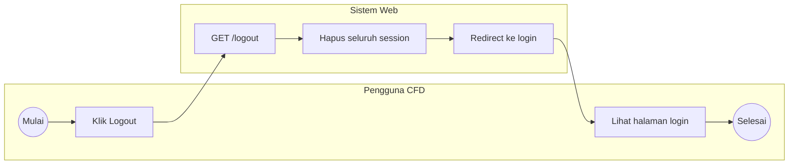

